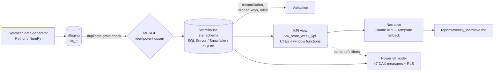

# Harvest – AI-Enabled Retail BI Platform

End-to-end analytics for a 12-store retail / food-service chain: **sales, inventory, procurement and food waste**.
Synthetic data → star-schema warehouse → idempotent MERGE ETL → validated SQL KPI layer → Power BI model (DAX + RLS)
→ an LLM-written weekly KPI note that always has a template fallback.



## What's verified, and what isn't
| Part | Status |
|---|---|
| Data generator, ETL, validation, KPI view, narrative fallback | **Run and tested** on SQLite: `pytest` → 12 tests pass; two consecutive pipeline runs give identical row counts |
| Claude API narrative path | Written, **not exercised here** (needs your `ANTHROPIC_API_KEY`); the failure path is tested |
| SQL Server DDL, MERGE procs, `usp_kpi_summary`, `usp_supplier_scorecard` | Generated / written but **not executed** – run them on your instance and fix any dialect issue |
| Snowflake DDL + MERGE | Generated but **not executed** |
| Power BI model | Not a `.pbix`: DAX, relationships and RLS are specified in `powerbi/` for you to build and test |

## Quick start (no database needed)
```bash
python -m venv .venv && source .venv/bin/activate        # Windows: .venv\Scripts\activate
pip install -r requirements.txt
cd src
python -m harvest.run_pipeline --target sqlite --generate     # builds ../harvest.db and ../reports/weekly_narrative.md
cd .. && pytest -q
```
Optional: `export ANTHROPIC_API_KEY=...` (and `HARVEST_CLAUDE_MODEL=<model id>` to override the default) to get the
narrative from Claude instead of the template.

### SQL Server / Snowflake
1. Run `sql/<target>/01_schema.sql`, and on SQL Server `02_merge_procs.sql` then `03_kpi_procs.sql`.
2. Set env vars (`MSSQL_SERVER/USER/PASSWORD[/DATABASE]` or `SNOWFLAKE_ACCOUNT/USER/PASSWORD/WAREHOUSE[/DATABASE/SCHEMA]`),
   `pip install pyodbc` or `snowflake-sqlalchemy`.
3. `python -m harvest.run_pipeline --target sqlserver` (or `snowflake`).
4. On SQL Server replace `CREATE VIEW` with `CREATE OR ALTER VIEW` if you prefer not to drop/recreate (the loader does
   `DROP VIEW IF EXISTS` first, supported on 2016+).

Changing the model? Edit `src/harvest/schema.py`, then `python tools/gen_sql.py`.

## Repository layout
```
src/harvest/   schema.py · generate_data.py · etl.py · validate.py · kpi.py · narrative.py · run_pipeline.py · db.py
sql/           sqlserver/ snowflake/ sqlite/ (generated DDL + MERGE) · kpi/vw_store_week_kpi.sql (shared KPI layer)
powerbi/       measures.dax (47 measures) · model_guide.md (tables, relationships, report pages)
docs/          design_decisions.md · kpi_definitions.md · rls_guide.md · rls_expected_values.csv
tools/         gen_sql.py · rls_expected.py
tests/         generator, ETL idempotency, validation, KPI view, narrative fallback
data/          seed-42 CSVs (≈5 MB) so you can open Power BI without running Python
```

## KPIs
Net sales and week-over-week change, gross margin %, waste % of COGS, stockout rate, supplier on-time %, fill rate.
Definitions (identical in SQL, DAX and the narrative): `docs/kpi_definitions.md`.

## Data quality gates
- **Before MERGE:** duplicate grain in every staging table (hard stop).
- **After MERGE:** staging-vs-warehouse totals for every fact measure, orphan keys on every foreign key,
  business rules (no negative sales/stock, stockout flag matches on-hand, PO received ≥ order date, received ≤ ordered).
- **Re-run test:** loading the same data twice leaves every row count unchanged; changing a source row updates it in place.

## Row-level security
Mapping-table pattern (`security_user_access`) with Executive / Regional / Store roles filtering `Store` only,
default-deny for unknown users, plus a test plan and expected values per persona: `docs/rls_guide.md`.

## Sample output (default seed)
> For the week starting 2026-06-29, net sales were 9,012,847 (-1.4% vs the prior week). Gross margin was 26.5% … Supplier
> on-time delivery was 83.8%, down from 84.8%. The weakest store was Harvest Ahmedabad (West) at -9.9% week over week.

The generator deliberately degrades one supplier (Supplier C: ~82% → ~43% on-time over the last three weeks) so the
supplier page has a real problem to find.

## Design decisions and limits
`docs/design_decisions.md` – including the trade-offs and what this project does not do.
